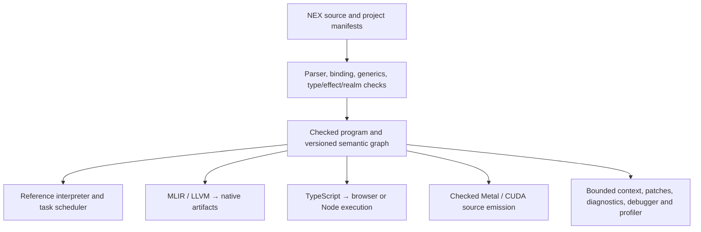

# NEX architecture

NEX is a checked language, a versioned semantic graph and a development toolchain.
Humans and models author the same source. Native applications run independently
of an LLM. The selected compiler's `describe` output defines its capabilities;
[the current status](STATUS.current.md) separates source implementation, physical
execution and matching SDK acceptance. [The specification](language.md) and
[grammar](grammar.ebnf) define the language; [PLAN](../PLAN.md) includes unfinished work.

Toolchain0.165.0, source language0.28, checked program format16, task ABI7 and
C FFI ABI major1 are different versioned contracts. A toolchain update does not
necessarily change the language. Graph upgrades use explicit history-preserving
migration; editing a version field alone is not migration.

## Frontend and graph

[The frontend](../src/language.cpp), [generics](../src/generics.cpp),
[matching](../src/matching.cpp) and [module loader](../src/modules.cpp) produce one
checked program. Checks include types, exact callable effects, execution realms,
exhaustive patterns and source contracts. There is no separate model-only parser.

[Graph storage](../src/graph_store.cpp), [operation storage](../src/operation_store.cpp)
and [change history](../src/change_store.cpp) use SQLite. Content hashes identify
semantic content; local persistent IDs identify nodes within a store. Revisions,
source hashes, generated operation sites and application build identities serve
different purposes. Context queries and guarded patches retrieve and change bounded
parts of this graph. They do not require reloading the entire project into a model.

## Execution and values

[Reference execution](../src/interpreter.cpp) and its independent
[task scheduler](../src/task_reference.cpp) provide observable semantic controls.
[Native lowering](../src/backend.cpp) uses MLIR/LLVM22.1. Checked arithmetic,
left-to-right evaluation, short-circuiting, strict UTF-8, Unicode scalar operations
and immutable aggregates are shared contracts. Native code retains owned cleanup
on normal/error/trap/cancellation exits. Resource aliases share controlled identity.

Expected errors are Result values. Typed source errors, ordered handlers and
finally are separate from fatal traps and request cancellation. User finalizers
run for the advertised normal/source-error paths; fatal control skips them while
runtime-owned cleanup still runs. See [source errors](exceptions.md).

Native structured tasks use bounded joined workers, scopes, futures and channels.
The reference and TypeScript schedulers have their own cooperative execution
contracts; native parallel CPU execution does not imply parallel browser threads.
See [concurrency](concurrency-design.md) and [task lifetimes](task-lifetimes.md).

## Backends and adapters

| Component | Implementation and boundary |
| --- | --- |
| Native CPU | MLIR/LLVM artifacts, cached function/runtime objects and captured source/dependency inputs. Library hosts use the actual [entry ABI](native-entry-abi.md). |
| Browser | [TypeScript generation](../src/typescript.cpp), locked React/Vite dependencies and explicit UI/worker/network-command adapters. Only reachable client/shared code is emitted. See [web](web.md). |
| GPU | [Metal](../src/metal.cpp) and [CUDA](../src/cuda.cpp) lower supported checked pure code. Emission grants no device authority. [The GPU guide](gpu-codegen.md) lists backend/type limits and exact evidence. |
| Files/network/storage | Explicit host grants and task/provider contracts; effects alone grant no OS authority. Remaining asynchronous integrations are recorded separately. |
| FFI and device resources | [C API](../runtime/nex_ffi.h), pinned foreign bundles, owned parent/child resources, quotas and physical completion. Trusted native modules remain an explicit boundary. |
| Project delivery | [Component build planning](../src/project_build.cpp), captured inputs, static/dynamic edges, native/web packages and separate portable SDK assembly. Fully static delivery is an explicit remaining policy, not implied by native output. |

NPU providers currently cover advertised operations on particular devices; general
NPU compilation and Apple NPU integration remain unfinished. Mobile/native UI,
NEX Studio and project conversion are also pending. A CPU fallback is not proof
that an accelerator executed the operation.

## Tools, installation and evidence

Debuggers, native/core diagnostics and profiles bind retained source, operation
and image/build identities. Exact optimized instruction attribution and full GPU/
browser profiling remain limited; see [debugging](debugging.md) and
[profiling](profiling.md). Successful code generation is not execution evidence.

The [LLM contract](../llm/SYSTEM_PROMPT.md) starts with indexed discovery and bounded
context. It records no measured token-saving claim. The existing
[cost ledger](../experiments/quality/llm_cost.md) checks accounting; actual comparable
multi-model experiments remain required by [the quality criteria](quality.md).

Source builds require C++20, CMake3.25+, LLVM/MLIR22.1.x, SQLite, OpenSSL3, Z3 and
Python3.10+. Browser workflows additionally need the locked Node/npm cohort.
[The installation guide](getting-started.en.md) supplies commands;
[SDK assembly](sdk.md) and [archive tooling](../tools/sdk_archive.py) describe
separate delivery checks. One platform's archive or older compiler's receipt does
not qualify a changed source tree or another platform.

The [previous architecture document](history/architecture-before-2026-11-10.md)
is retained as historical data. It contains earlier version/platform assumptions
and must not be used as the current capability list.
