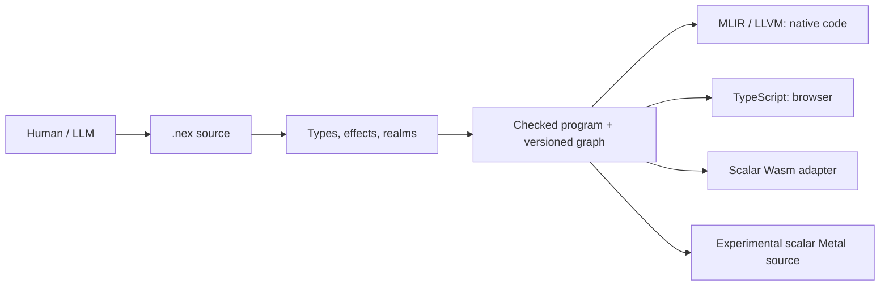

# Why NEX exists

Current source is **toolchain 0.232.0 / language 0.28 / task ABI 7**, in
development. It includes ordinary source contracts and experimental checked
scalar Metal emission. Complete matching portable SDK qualification remains
pending. The [current platform summary](../README.md#development-status) links
exact source and hardware records; [STATUS](../STATUS.md) retains the history.
Older SDK archives keep their own source, compiler and acceptance identities.

[Русский](overview.ru.md) · [Start here](getting-started.en.md)

NEX means **Neural Execution Language**. The project explores a practical question:
how can a person and a language model express, change and verify a large program
with less repeated context, while keeping execution efficient and behavior precise?
The goal is maximum exact meaning per necessary token, high performance and safe
execution. NEX is still a development language; its advantages must be measured.

## The principle

The common unit of work is a checked program with explicit dependencies and
history. Readable `.nex` source is parsed and checked. The semantic graph records
functions, types, operations and revisions. Persistent IDs identify objects in
one store; content hashes identify canonical checked content. Guarded changes can reject stale
context instead of silently overwriting another revision.

A model can ask `nex describe --field PATH --json` about one feature and
`nex context --symbol NAME --json` about one symbol. It can then make a bounded
change, check it and run the relevant tests. The graph is useful to people too:
changes, debugger views, profiles and captured builds can refer to exact source
and build identities.

MLIR/LLVM generates native code. A separate TypeScript backend supports browser
workflows, and a narrow scalar adapter emits Wasm. Programs run without a model
service. NEX has its own semantics; the compiler does not translate source to
C++ as an execution fallback.

## The language

Functions have explicit parameter/result types. The core includes checked `i64`,
finite `f64`, strict UTF-8 strings with Unicode-scalar operations, bytes,
immutable collections and aggregates, enums and exhaustive matching, generics,
traits and snapshot closures. `var` permits rebinding; aggregate aliases do not
become arbitrary mutable pointers.

Effects include `io`, `db`, `fs`, `ffi`, `task` and `throw`. Realms separate
client, server and shared code. An effect declaration describes a permitted kind
of operation; filesystem/device authority still requires actual operator grants.
Browser output includes reachable client/shared code under the checked boundary.

Ordinary expected failures can use `result<T>` and `?`. Since language 0.27, NEX supports
owned typed `throw(value)`, ordered typed/legacy catches, filters and `finally`,
including task suspension. Checked traps, cancellation and execution limits are
separate outcomes. They do not become catchable source errors; user finalizers
are skipped on those fatal outcomes while runtime-owned cleanup remains required.

Structured tasks have bounded scopes, futures, channels, deadlines and ownership
rules. `parallel_map` uses bounded joined CPU threads in its native scope;
reference and TypeScript evaluation are sequential semantic oracles. Long browser
work can use the separately checked Worker adapter. These execution models have
separate contracts, discoverable from the selected compiler.

`nex.build.json` describes project components and static/dynamic edges. Static
component linkage does not imply an executable with no system dependencies.
Native HTTP/API and browser adapters share checked models. Opaque resources and
FFI providers retain explicit lifetimes, ABI versions and trust boundaries.

## Measurements

Acceleration has three independent dimensions: time to produce an accepted
change, rebuild latency, and application execution. A shorter source file alone
does not measure any complete development task.

A [historical checked-core observation](evidence/checked-core-0.134.4-current.json)
used toolchain 0.134.4 / language 0.24, one checked-integer recurrence, 100 million
steps per invocation and five repetitions. Median wall seconds were:

| Host | NEX | Checked C++ | CPython |
|---|---:|---:|---:|
| macOS ARM64 | 0.316214 | 0.314782 | 10.270906 |
| Linux ARM64 VM | 0.361694 | 0.308447 | 8.527467 |

The host was not isolated. The C++ comparison does not implement NEX task
cancellation/limit machinery. These observations are scoped to one algorithm
and older versions; they are not current-toolchain benchmarks or universal language
comparisons. The Linux observation missed that experiment's 90% C++ throughput goal.

A separate [0.96 build-cache experiment](evidence/native-scale-0.96.0.json) used
100 modules and 10,000 declared functions, 9,900 reachable. Cold, unchanged and
single-function-edit builds compiled 9,900, 0 and 1 functions respectively. Observed
latencies were 585.43 s, 25.48 s and 84.38 s on one Mac with a compiler observer.
That demonstrates reuse in the recorded corpus, not model-token savings.

The user-selected [local Qwen3.8 27B study](llm-cost-qwen38-27b-2026-11-11.en.md)
completed60 attempts: NEX4/20 accepted, C++14/20 and Python20/20. Including all
failures, NEX used821,214 tokens, C++254,634 and Python212,556. No saving was
demonstrated. Other-model/workload comparisons remain unmeasured. The
[quality protocol](quality.md) counts full context/tools/retries/correctness;
the project's30% reduction objective is not an achieved result.

The [0.162 SDK measurement](releases/0.162.0.json) repeats the checked recurrence
for 100 million steps and five samples per language. Median wall times on this
Mac were 0.295775 s for NEX, 0.278295 s for checked C++ and 7.366667 s for Python.
The host was not isolated; this is one workload. Its recorded 100-module,
10,000-declaration workflow also confirmed actual LLVM calls of 9900/0/1 for
cold/unchanged/single-function-edit builds. Neither result measures LLM savings.

A [separate 0.162.2 repetition](evidence/macos-sdk-0.162.2-2026-11-08.json) measured
0.293156 s NEX, 0.274216 s checked C++ and 7.325599 s Python medians using 15 new
samples. Its 100-module workflow again made 9900/0/1 actual LLVM calls. The same
one-workload and unisolated-host limits apply.

## Hardware and delivery

Development 0.165 adds [checked scalar Metal emission](gpu-codegen.md). Its
installed owned-provider tools passed [15 reference/native pairs and 24 physical
Metal kernels](evidence/macos-installed-public-Metal-tools-0.165.0-2026-11-10.json)
on Apple M5 Max. These ordinary-installation checks do not accept the matching
immutable SDK. GPU operation stepping/profiling and broader types/backends remain
pending.

On Windows, [snapshot `2172b35`](evidence/windows-latest-build-CUDA-0.165.0-2026-11-10.json)
passed all targets, eleven selected groups, 35 physical CUDA cases and 36 Compute
Sanitizer cases on RTX 3090. The [CIX `979ef54` record](evidence/cix-current-source-GPU-NPU-0.165.0-2026-11-10.json)
reports 36 GPU and 26 NPU calls, with ZhouyiExecutionProvider and CPU fallback
disabled for NPU. Each uses its own pinned ordinary development installation;
complete source and portable SDK qualification remain separate.

The earlier [0.162 SDK record](releases/0.162.0.json) retains its 300 source groups,
moved/restored workflows, browser and OpenCL scope. It does not qualify the
current 0.165 source or SDK. Matching Windows/Linux portable delivery, Apple NPU,
remaining GPU/NPU operations, mobile/native UI, broader algebraic effects,
remaining network/DB integrations, project conversion and NEX Studio remain in
[PLAN](../PLAN.md). The selected Qwen study found no token saving; improvements
and any later matched measurements retain that original result.

Read the [normative specification](language.md), [grammar](grammar.ebnf),
[architecture](architecture.md) and [model-independent workflow](../llm/LEARNING.md).
Use the actual compiler to distinguish implemented support from proposals.

The public compiler also emits CUDA C++20 through `nex emit --kind cuda`.
Its checked subset includes finite f64, fixed records/enums/Results, `as_i64`,
bounded immutable lists/bytes, explicit dynamic UTF-8, source/loop contracts and nested guarded matches; the generated record binds source maps and reachable hashes to
the selected compiler/revision. CUDA provider preparation uses this compiler
directly. Device authority, physical execution and SDK qualification remain
explicit, separate steps. See [the GPU guide](gpu-codegen.md#cuda-source-emission).
