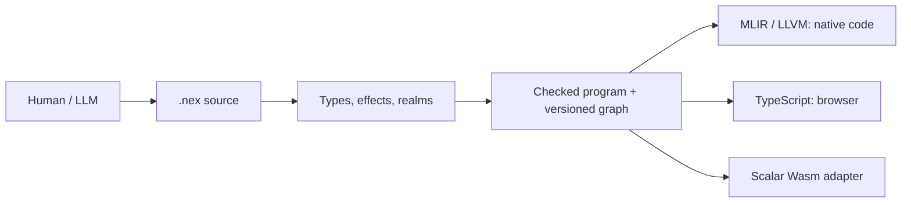

# Why NEX exists

Toolchain 0.159.0 / language 0.28 exposes source contracts in the ordinary CLI.
Pure function and loop clauses remain checked in release code. Existing 0.27
histories need explicit migration. The [Mac development SDK receipt](releases/0.159.0.json)
records current acceptance; other platforms keep separate, versioned evidence.

[Русский](overview.ru.md) · [Start here](getting-started.en.md)

NEX means **Neural Execution Language**. The project explores a practical question:
how can a person and a language model express, change and verify a large program
with less repeated context, while keeping execution efficient and behavior precise?
The goal is maximum exact meaning per necessary token, high performance and safe
execution. NEX is still a development language; its advantages must be measured.

## The principle

The common unit of work is a checked program with explicit dependencies and
history. Readable `.nex` source is parsed and checked. The semantic graph records
functions, types, operations and revisions. Persistent IDs identify objects in
one store; content hashes identify canonical checked content. Guarded changes can reject stale
context instead of silently overwriting another revision.

A model can ask `nex describe --field PATH --json` about one feature and
`nex context --symbol NAME --json` about one symbol. It can then make a bounded
change, check it and run the relevant tests. The graph is useful to people too:
changes, debugger views, profiles and captured builds can refer to exact source
and build identities.

MLIR/LLVM generates native code. A separate TypeScript backend supports browser
workflows, and a narrow scalar adapter emits Wasm. Programs run without a model
service. NEX has its own semantics; the compiler does not translate source to
C++ as an execution fallback.

## The language

Functions have explicit parameter/result types. The core includes checked `i64`,
finite `f64`, strict UTF-8 strings with Unicode-scalar operations, bytes,
immutable collections and aggregates, enums and exhaustive matching, generics,
traits and snapshot closures. `var` permits rebinding; aggregate aliases do not
become arbitrary mutable pointers.

Effects include `io`, `db`, `fs`, `ffi`, `task` and `throw`. Realms separate
client, server and shared code. An effect declaration describes a permitted kind
of operation; filesystem/device authority still requires actual operator grants.
Browser output includes reachable client/shared code under the checked boundary.

Ordinary expected failures can use `result<T>` and `?`. Since language 0.27, NEX supports
owned typed `throw(value)`, ordered typed/legacy catches, filters and `finally`,
including task suspension. Checked traps, cancellation and execution limits are
separate outcomes. They do not become catchable source errors; user finalizers
are skipped on those fatal outcomes while runtime-owned cleanup remains required.

Structured tasks have bounded scopes, futures, channels, deadlines and ownership
rules. `parallel_map` uses bounded joined CPU threads in its native scope;
reference and TypeScript evaluation are sequential semantic oracles. Long browser
work can use the separately checked Worker adapter. These execution models have
separate contracts, discoverable from the selected compiler.

`nex.build.json` describes project components and static/dynamic edges. Static
component linkage does not imply an executable with no system dependencies.
Native HTTP/API and browser adapters share checked models. Opaque resources and
FFI providers retain explicit lifetimes, ABI versions and trust boundaries.

## Measurements

Acceleration has three independent dimensions: time to produce an accepted
change, rebuild latency, and application execution. A shorter source file alone
does not measure any complete development task.

A [historical checked-core observation](evidence/checked-core-0.134.4-current.json)
used toolchain 0.134.4 / language 0.24, one checked-integer recurrence, 100 million
steps per invocation and five repetitions. Median wall seconds were:

| Host | NEX | Checked C++ | CPython |
|---|---:|---:|---:|
| macOS ARM64 | 0.316214 | 0.314782 | 10.270906 |
| Linux ARM64 VM | 0.361694 | 0.308447 | 8.527467 |

The host was not isolated. The C++ comparison does not implement NEX task
cancellation/limit machinery. These observations are scoped to one algorithm
and older versions; they are not current 0.159.0 benchmarks or universal language
comparisons. The Linux observation missed that experiment's 90% C++ throughput goal.

A separate [0.96 build-cache experiment](evidence/native-scale-0.96.0.json) used
100 modules and 10,000 declared functions, 9,900 reachable. Cold, unchanged and
single-function-edit builds compiled 9,900, 0 and 1 functions respectively. Observed
latencies were 585.43 s, 25.48 s and 84.38 s on one Mac with a compiler observer.
That demonstrates reuse in the recorded corpus, not model-token savings.

A cross-model study of complete accepted tasks is still pending. The
[quality protocol](quality.md) counts input/output, retrieved context, tool
responses, retries, time and correctness. The project's 30% token-reduction
objective is a target, not an achieved result.

## Hardware and delivery

The [current Mac OpenCL receipt](evidence/macos-opencl-0.159.0.json) covers one
Apple M5 Max: U8 Add/Affine, 21 native/reference scenarios, six source profiles
and 47 physical kernel events. Installed source clauses and detached contracts
compose with typed owned resources. [Linux accelerator evidence](evidence/accelerators-0.151.0.json)
retains its CIX/RK and version scope. General GPU code generation remains pending.

The [0.159 SDK record](releases/0.159.0.json) includes 296 CTest groups and two
installed 41-phase workflows plus 57 extra cases each. The same archive passed
150 actual production-browser checks. Earlier Windows 0.152.1 receipts establish
their own native/CUDA scope; current Windows/Linux qualification, Metal compute,
Apple NPU, broader device operations, mobile/native UI, general algebraic effects,
remaining network/DB integrations, project conversion and NEX Studio remain in
[PLAN](../PLAN.md). Complete accepted-task token savings remain to be measured.

Read the [normative specification](language.md), [grammar](grammar.ebnf),
[architecture](architecture.md) and [model-independent workflow](../llm/LEARNING.md).
Use the actual compiler to distinguish implemented support from proposals.
