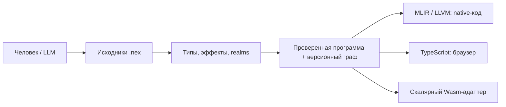

# Зачем нужен NEX

[English](overview.en.md) · [Начать работу](getting-started.ru.md)

NEX — **Neural Execution Language**, язык нейронного исполнения. Проект исследует,
как человеку и языковой модели описывать, изменять и проверять крупную программу
с меньшим повторным контекстом, сохраняя точное поведение и эффективное исполнение.
Цель — максимум точного смысла на необходимый токен, высокая производительность
и безопасность. Язык ещё развивается; преимущества подтверждаются измерениями.

## Основной принцип

Работа строится вокруг проверяемой программы с явными зависимостями и историей.
Читаемые `.nex` исходники проходят разбор и проверку. Семантический граф хранит
функции, типы, операции и ревизии. Постоянные ID различают объекты одного
хранилища, а хеши — каноническое проверенное содержимое. Защищённая правка может отклонить устаревший
контекст вместо незаметной перезаписи другой ревизии.

Модель запрашивает одну возможность через `nex describe --field PATH --json`
и ограниченный контекст символа через `nex context --symbol NAME --json`.
Затем вносит небольшую правку, проверяет её и запускает нужные тесты.
Граф полезен и человеку: изменения, debugger, профиль и сохранённая сборка
могут ссылаться на точные исходники и идентичность исполняемого образа.

MLIR/LLVM генерирует нативный код. Отдельный backend формирует TypeScript для
браузера, а ограниченный скалярный адаптер — Wasm. Готовая программа работает
без сервиса LLM. У NEX собственная семантика; запасного пути исполнения через
перевод исходника в C++ у компилятора нет.

## Язык

Функции имеют явные типы параметров и результата. В ядре есть проверяемый `i64`,
конечный `f64`, строгий UTF-8 и операции над Unicode-символами, байты,
неизменяемые коллекции и агрегаты, enum и исчерпывающий match, generics,
traits и замыкания со снимками захватов. `var` разрешает новое присваивание;
псевдонимы агрегатов не превращаются в произвольные изменяемые указатели.

Эффекты включают `io`, `db`, `fs`, `ffi`, `task`, `throw`. Realms разделяют
client, server и shared-код. Объявление эффекта описывает разрешённый вид
операции; доступ к файлам и устройствам всё равно требует настоящих прав
оператора. Браузер получает достижимый client/shared-код в проверяемых границах.

Для ожидаемых ошибок есть `result<T>` и `?`. Язык0.27 также поддерживает
типизированный `throw(value)` с владением значением, упорядоченные typed/legacy
catch, фильтры и `finally`, в том числе при приостановке задач. Проверяемые
ловушки, отмена и ограничения исполнения остаются отдельными исходами.
Они не становятся перехватываемыми source errors. Пользовательские finalizer
при этих фатальных исходах пропускаются, а очистка ресурсов runtime обязательна.

Структурированные задачи имеют ограниченные области, futures, каналы, сроки
и правила владения. Native `parallel_map` использует ограниченное число
присоединяемых CPU-потоков; интерпретатор и TypeScript служат последовательными
семантическими эталонами. Для долгой браузерной работы есть отдельный проверяемый
Worker-адаптер. Контракты этих моделей сообщает выбранный компилятор.

`nex.build.json` задаёт компоненты и статические/динамические связи проекта.
Статическая связь компонента сама по себе не устраняет системные зависимости
исполняемого файла. Native HTTP/API и браузер используют общие проверенные
модели. Непрозрачные ресурсы и FFI-провайдеры сохраняют явные сроки жизни,
версии ABI и границы доверия.

## Измерения

Ускорение имеет три независимые стороны: время получения принятой правки,
задержку пересборки и исполнение приложения. Короткий исходник сам по себе
не измеряет полную стоимость разработки.

[Историческое checked-core наблюдение](evidence/checked-core-0.134.4-current.json):
toolchain 0.134.4 / язык 0.24, один целочисленный алгоритм, 100 миллионов шагов за
запуск, пять повторов. Медианы времени в секундах:

| Платформа | NEX | Проверяемый C++ | CPython |
|---|---:|---:|---:|
| macOS ARM64 | 0.316214 | 0.314782 | 10.270906 |
| Linux ARM64 VM | 0.361694 | 0.308447 | 8.527467 |

Компьютер не был изолирован от другой нагрузки. C++-эталон не включает
механизм отмены/ограничений задач NEX. Результаты относятся к одному алгоритму
и прежним версиям; они не являются измерениями 0.152.1 или общим сравнением
языков. Linux-наблюдение не достигло цели того эксперимента — 90% throughput C++.

[Отдельный эксперимент кэша0.96](evidence/native-scale-0.96.0.json) использовал
100 модулей и10 000 объявленных функций, из которых 9900 достижимы.
Холодная сборка, повторная без изменений и сборка после правки одной функции
скомпилировали 9900, 0 и 1 функцию. Задержки на одном Mac с наблюдателем компилятора
составили 585,43 с, 25,48 с и 84,38 с. Это подтверждает повторное использование в
указанном наборе, но не экономию токенов модели.

Сравнение полных принятых задач между несколькими LLM ещё предстоит.
[Протокол качества](quality.md) учитывает input/output, полученный контекст,
ответы инструментов, исправления, время и корректность. Цель проекта — снизить
общий расход токенов минимум на 30%; достигнутым результатом она пока не заявлена.

## Устройства и поставка

[Mac OpenCL-проверка](evidence/macos-opencl-0.151.1.json) относится к одному
Apple M5 Max: U8 Add/Affine, 31 сценарий, 64 исполнения и 48 запусков ядер на GPU,
включая перенос принадлежащего буфера в типизированной ошибке.
[Linux-результаты](evidence/accelerators-0.151.0.json) относятся к конкретным
провайдерам CIX/RK и своей версии. Автоматическая компиляция произвольных
NEX-функций на GPU этими результатами не подтверждается.

Приёмка SDK записана отдельно в [состоянии поставки](releases/0.152.1.json).
Native Windows/CUDA, Metal, Apple NPU, остальные операции устройств, мобильный
и native UI, общие алгебраические эффекты, оставшиеся network/DB-интеграции,
перенос проектов и NEX Studio остаются в [PLAN](../PLAN.md).

[Спецификация](language.md), [грамматика](grammar.ebnf), [архитектура](architecture.md)
и [общий рабочий процесс LLM](../llm/LEARNING.md) описывают правила работы.
Отличайте реализованную возможность от предложения с помощью самого компилятора.
