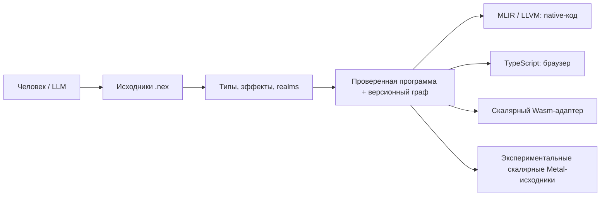

# Зачем нужен NEX

[English](overview.en.md) · [Начать работу](getting-started.ru.md)

NEX — **Neural Execution Language**, язык нейронного исполнения. Проект исследует,
как человеку и языковой модели описывать, изменять и проверять крупную программу
с меньшим повторным контекстом, сохраняя точное поведение и эффективное исполнение.
Цель — максимум точного смысла на необходимый токен, высокая производительность
и безопасность.

**SDK 1.0.0** создаёт новые проекты на языке **0.30**.
Существующий проект может явно выбрать 0.28, 0.29 или 0.30. При отсутствии
версии компилятор использует 0.28. Для каждого опубликованного архива указаны
компилятор, платформа и результаты приёмки.
[SDK 1.0.0 для четырёх платформ](https://github.com/sae-ru/NEX/releases/tag/v1.0.0) · [Состояние платформ](../README.ru.md#состояние-разработки) · [Условия совместимости 1.x](compatibility.ru.md)

## Основной принцип

Работа строится вокруг проверяемой программы с явными зависимостями и историей.
Читаемые `.nex` исходники проходят разбор и проверку. Семантический граф хранит
функции, типы, операции и ревизии. Постоянные ID различают объекты одного
хранилища, а хеши — каноническое проверенное содержимое. Защищённая правка может отклонить устаревший
контекст вместо незаметной перезаписи другой ревизии.

Команда `nex describe --field project_languages --json` показывает модели, какие
версии языка поддерживает установленный SDK. В новом проекте команда
`nex context src/main.nex --kind brief --symbol app::main --json` показывает функцию
входа и её непосредственные зависимости. Затем модель может изменить функцию и
запустить нужные тесты.
Граф полезен и человеку: изменения, debugger, профиль и сохранённая сборка
могут ссылаться на точные исходники и идентичность исполняемого образа.

MLIR/LLVM генерирует нативный код. Отдельный backend формирует TypeScript для
браузера, а ограниченный скалярный адаптер — Wasm. Готовая программа работает
без сервиса LLM. У NEX собственная семантика; запасного пути исполнения через
перевод исходника в C++ у компилятора нет.

## Язык

Функции имеют явные типы параметров и результата. В ядре есть проверяемый `i64`,
конечный `f64`, строгий UTF-8 и операции над Unicode-символами, байты,
неизменяемые коллекции и агрегаты, enum и исчерпывающий match, generics,
traits и замыкания со снимками захватов. `var` разрешает новое присваивание;
псевдонимы агрегатов не превращаются в произвольные изменяемые указатели.

В языке 0.30 несколько частей программы могут разделять состояние через явную
ссылку `cell<T>`. Для чтения и записи ячейки функция объявляет эффект `state`.
[Правила работы со ссылками](references030.md)

К другим эффектам относятся `io`, `db`, `fs`, `ffi`, `task` и `throw`. Realms разделяют
client, server и shared-код. Объявление эффекта описывает разрешённый вид
операции; доступ к файлам и устройствам всё равно требует настоящих прав
оператора. Браузер получает достижимый client/shared-код в проверяемых границах.

Для ожидаемых ошибок есть `result<T>` и `?`. Начиная с языка 0.27 поддерживаются
типизированный `throw(value)` с владением значением, упорядоченные typed/legacy
catch, фильтры и `finally`, в том числе при приостановке задач. Проверяемые
ловушки, отмена и ограничения исполнения остаются отдельными исходами.
Они не становятся перехватываемыми source errors. Пользовательские finalizer
при этих фатальных исходах пропускаются, а очистка ресурсов runtime обязательна.

Структурированные задачи имеют ограниченные области, futures, каналы, сроки
и правила владения. Native `parallel_map` использует ограниченное число
присоединяемых CPU-потоков; интерпретатор и TypeScript служат последовательными
семантическими эталонами. Для долгой браузерной работы есть отдельный проверяемый
Worker-адаптер. Контракты этих моделей сообщает выбранный компилятор.

`nex.build.json` задаёт компоненты и статические/динамические связи проекта.
Статическая связь компонента сама по себе не устраняет системные зависимости
исполняемого файла. Native HTTP/API и браузер используют общие проверенные
модели. Непрозрачные ресурсы и FFI-провайдеры сохраняют явные сроки жизни,
версии ABI и границы доверия.

## Измерения

Ускорение имеет три независимые стороны: время получения принятой правки,
задержку пересборки и исполнение приложения. Короткий исходник сам по себе
не измеряет полную стоимость разработки.

[Историческое checked-core наблюдение](evidence/checked-core-0.134.4-current.json):
toolchain 0.134.4 / язык 0.24, один целочисленный алгоритм, 100 миллионов шагов за
запуск, пять повторов. Медианы времени в секундах:

| Платформа | NEX | Проверяемый C++ | CPython |
|---|---:|---:|---:|
| macOS ARM64 | 0.316214 | 0.314782 | 10.270906 |
| Linux ARM64 VM | 0.361694 | 0.308447 | 8.527467 |

Компьютер не был изолирован от другой нагрузки. C++-эталон не включает
механизм отмены/ограничений задач NEX. Результаты относятся к одному алгоритму
и прежним версиям; они не являются измерениями текущего инструментария или общим сравнением
языков. Linux-наблюдение не достигло цели того эксперимента — 90% throughput C++.

[Отдельный эксперимент кэша0.96](evidence/native-scale-0.96.0.json) использовал
100 модулей и10 000 объявленных функций, из которых 9900 достижимы.
Холодная сборка, повторная без изменений и сборка после правки одной функции
скомпилировали 9900, 0 и 1 функцию. Задержки на одном Mac с наблюдателем компилятора
составили 585,43 с, 25,48 с и 84,38 с. Это подтверждает повторное использование в
указанном наборе, но не экономию токенов модели.

[Выбранный пользователем замер локальной Qwen3.8 27B](llm-cost-qwen38-27b-2026-11-11.ru.md)
завершил60 попыток: принято4/20 NEX,14/20 C++ и20/20 Python. С отказами NEX
потребовал 821 214 токенов, C++ — 254 634, Python — 212 556. В этом замере
экономия не подтвердилась. [Протокол качества](quality.md) учитывает весь
контекст, инструменты, исправления и корректность; цель снижения на30% не достигнута.

[Версия2 на0.280.1](llm-cost-qwen38-27b-2026-11-17.ru.md) завершила60 попыток:
принято6/20 NEX,18/20 C++ и20/20 Python. Известные суммы токенов —890724,
278472 и128922, но у двух вызовов NEX расход неизвестен; точный итог и отношение
расходов NEX недоступны. Ограничения ревью и изменения порядка продолжения
сохранены. Изменились runtime, язык и справка; причинную роль одного короткого
промпта этот результат не доказывает.

Codex трижды исправил одну и ту же ошибку в складском счёте на каждом языке.
Все девять исправлений прошли одинаковые сценарии приёмки. В среднем до принятого
исправления прошло 25,69 с на NEX, 20,89 с на C++20 и 19,89 с на Python.
На NEX ушло 71 809 токенов, из них 56 448 входных токенов прочитаны из кэша.
Замер охватывает одну ошибку на одном Mac.
[Время, токены и вклад кэша по каждому языку](codex-billing-languages-2026-11-23.ru.md)

В отдельном замере Codex дважды исправил каждую из трёх ошибок NEX в каждом
режиме. Все 12 исправлений прошли приёмку. Когда SDK добавлял к диагностике
фрагмент функции, на шесть исправлений ушло 344 777 входных и выходных токенов
вместо 396 127. Экономия составила 13,0%. Обе суммы включают токены, прочитанные
из кеша, по одному разу. При обычной диагностике исправление заняло в среднем
24,12 с, с фрагментом функции — 24,16 с. [Результаты всех прогонов и учёт кеша](https://github.com/sae-ru/NEX/blob/7e69d88e4295fe714997751283be70ba510ee582/docs/evidence/test-repair-context-cost-2026-11-23.json)

[Измерение SDK0.162](releases/0.162.0.json) повторяет проверяемый целочисленный
алгоритм: 100 миллионов шагов, пять измерений для каждого языка. Медианы на этом
Mac: NEX — 0,295775 с, проверяемый C++ — 0,278295 с, Python — 7,366667 с.
Компьютер не был изолирован; это один алгоритм. Зафиксированный проект из 100 модулей
и 10 000 объявлений подтвердил 9900/0/1 вызов LLVM для первой, повторной и
изменённой на одну функцию сборки. Экономию токенов LLM эти результаты не измеряют.

[Отдельный повтор 0.162.2](evidence/macos-sdk-0.162.2-2026-11-08.json) дал медианы
0,293156 с NEX,0,274216 с проверяемого C++ и 7,325599 с Python по 15 новым измерениям.
Проект из 100 модулей снова подтвердил 9900/0/1 реальный вызов LLVM. Ограничения
одного алгоритма и неизолированного компьютера сохраняются.

## Устройства и поставка

В разработке 0.165 появилась [генерация проверенного скалярного Metal-кода](gpu-codegen.md).
Установленные инструменты owned-провайдера прошли [15 пар reference/native и
24 физических ядра Metal](evidence/macos-installed-public-Metal-tools-0.165.0-2026-11-10.json)
на Apple M5 Max. Это проверки обычной установки; приёмка соответствующего
неизменяемого SDK ещё не завершена. Пооперационная пошаговая отладка и
профилирование GPU, дополнительные типы и backend остаются в плане.

На Windows [снимок `2172b35`](evidence/windows-latest-build-CUDA-0.165.0-2026-11-10.json)
прошёл все цели сборки, 11 выбранных групп, 35 физических CUDA-сценариев и
36 проверок Compute Sanitizer на RTX 3090. [Результат CIX `979ef54`](evidence/cix-current-source-GPU-NPU-0.165.0-2026-11-10.json)
фиксирует 36 GPU- и 26 NPU-вызовов с ZhouyiExecutionProvider и отключённым
CPU fallback для NPU. У каждой проверки свои закреплённые исходники и обычная
установка; полная регрессия и приёмка переносимого SDK остаются отдельными этапами.

Прежняя [квитанция SDK 0.162](releases/0.162.0.json) сохраняет свои 300 исходных
групп, результаты приёмки после переноса и распаковки, браузерные и OpenCL-проверки.
Более поздние результаты приведены в таблице платформ. Архив для Windows или
Linux можно выбрать по инструкции для своей ОС.
[Таблица платформ](../README.ru.md#состояние-разработки) · [Установка SDK](getting-started.ru.md)

В плане развития также описаны Apple NPU, дополнительные операции GPU и NPU,
мобильные и настольные интерфейсы, алгебраические эффекты, сетевые библиотеки,
интеграции с базами данных, конвертеры проектов и NEX Studio. [План](../PLAN.md)

[Спецификация](language.md), [грамматика](grammar.ebnf), [архитектура](architecture.md)
и [общий рабочий процесс LLM](../llm/LEARNING.md) описывают правила работы.
Отличайте реализованную возможность от предложения с помощью самого компилятора.

Публичная команда `nex emit --kind cuda` генерирует CUDA C++20 из проверенного
AST. Поддерживаются конечные f64, структуры, enum, `result`, `as_i64`,
списки, `bytes` и динамический UTF-8 с явной ёмкостью GPU, вложенный `match` с условиями и контракты функций/циклов; результат содержит карты исходников, хеши достижимых
функций и идентификатор компилятора/ревизии. Подготовка CUDA-провайдера использует
тот же компилятор. Доступ к устройству, физическое выполнение и приёмка SDK
проверяются отдельно. См. [описание GPU](gpu-codegen.md#cuda-source-emission).
