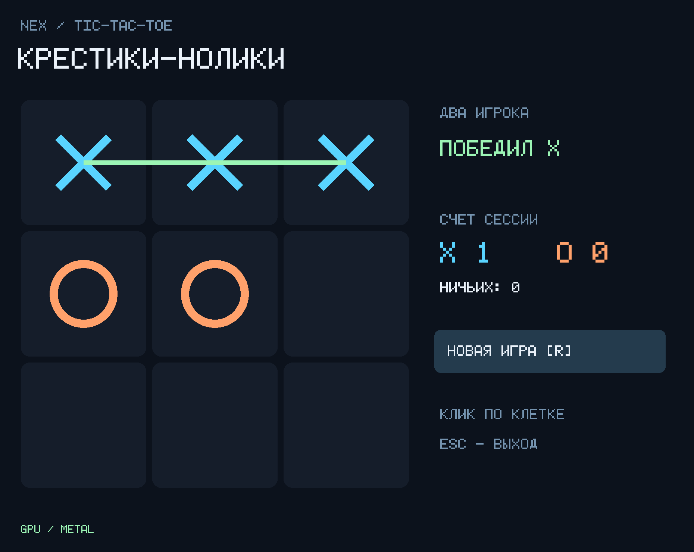

# Крестики-нолики — переносимый пример NEX

Общие исходники для **Windows, macOS и Linux**: правила, состояние, счёт и цикл
игры написаны на NEX, окно и аппаратная графика — на SDL 3.4.18 через явный C FFI.
Готовая программа каждой ОС собирается нативно. WSL не требуется.

Исходный SDL-вариант проверен на Windows x64 и RTX 3090, включая
native/reference/TypeScript, реальную очередь событий SDL и чтение пикселей GPU.
Текущий пересчёт Retina/letterboxing проверен на macOS ARM64: Metal, восемь
сценариев размеров окна, пять ходов до победы X и перенос автономного пакета
с запрещённым доступом к исходникам и SDK. Точные хеши, ограничения и приёмка —
в [отчёте macOS](../../docs/evidence/sdl-metal-retina-0.155.0.json).
Повторный запуск этого исправления на Windows и графическая Linux-приёмка
остаются открыты. Рецепт сборки SDL поддерживает все три платформы.

## Windows

Из обычного PowerShell/cmd в этом каталоге:

```bat
build.bat
test.bat
run.bat
package.bat
```

## macOS и Linux

```sh
sh build.sh
sh test.sh
sh run.sh
sh package.sh
```

Нужны нативный SDK NEX языка 0.27, Python 3.10+, CMake 3.24+ и Ninja.
Для TypeScript-проверки нужен Node.js с `--experimental-strip-types`.
Компиляторы выбираются из `nex doctor`; Visual Studio и NVCC не требуются.
На macOS нужны Apple SDK/Command Line Tools; на Linux — заголовки оконной
системы и OpenGL для сборки SDL, графическая сессия X11/Wayland и GPU-драйвер.
Платформенные зависимости SDL описаны в его официальном README-linux.md.

Первый запуск загружает закреплённый архив исходников SDL (около 15 MiB),
проверяет SHA-256 и собирает статическую библиотеку. Последующие сборки используют
кеш. Можно передать `--sdl-archive PATH` для работы без сети.
Зависимость и её точный хеш находятся в `vendor/dependencies.json`; лицензия
сохраняется в `vendor/SDL-LICENSE.txt` и в готовом пакете. Дополнительные
уведомления yuv2rgb, fdlibm и стандартных функций SDL находятся в
`vendor/SDL-THIRD-PARTY-NOTICES.txt` и также включаются в пакет.

Если компилятор не найден автоматически, задайте `NEX_EXE` или передайте
`--compiler PATH`. Для Python используйте `NEX_PYTHON`, для Node — `NEX_NODE`.
Поддерживаются пробелы и Unicode в пути проекта. На Windows выходные файлы
vendor linker собираются в ASCII-кеше; каталог можно выбрать переменной
`NEX_GAME_BUILD_ROOT`.

## Что где написано

```text
nex.json                язык 0.27, вход src/main.nex
src/rules.nex           неизменяемое поле, проверка ходов, победа, ничья, тесты
src/main.nex            цикл событий, счёт, закрытие ресурса в finally
src/gui.nex.in          переносимый контракт Window и пяти функций FFI
native/gui.cpp          SDL: окно, ввод, GPU, встроенные кириллические глифы
native/CMakeLists.txt   сборка SDL и нативного модуля
build_provider.py       закреплённая зависимость и выбор C/C++ toolchain
project.py              подписи FFI, сборка, тесты, упаковка
*.bat / *.sh            одинаковые действия на трёх ОС
```

`src/gui.nex`, `.build`, `.nex` и `dist` генерируются. Для проекта с нуля
достаточно исходников и первого `build`.

## Как устроен проект с нуля

1. Создайте проект через `nex init`, узнайте возможности через
   `nex describe --kind index --json`. Этот пример рассчитан на язык 0.27.
2. Вынесите чистые правила в модуль. `rules::move` возвращает новое значение
   `Game`; старое поле не меняется. Занятая клетка, выход за границы и ход после
   конца партии возвращают исходное состояние.
3. Объявите `server resource Window` и внешние функции с эффектом `ffi`.
   Это непрозрачный ресурс с управляемым временем жизни; C++ указатели в NEX
   не передаются. Нужный контекст можно получить через `nex context --symbol rules::move`.
4. Получите точные JSON-сигнатуры через `nex ffi --symbol gui::open --json`
   и остальные функции. `project.py` вычисляет SHA-256 канонического JSON,
   формирует `signatures.h` и собирает провайдер.
5. Создайте `nex.foreign-bundle/1` с хешами модуля, уведомлениями о лицензиях
   и подписями экспортов. Хеш манифеста подставляется вместо `@PIN@`.
   Операторский `.build/foreign.json` разрешает только пять функций примера.
6. Выполните `nex check`, `nex test --foreign .build/foreign.json`, `nex build`.
   Сырому EXE передайте `--nex-foreign .build/foreign.json`; `run` делает это сам.
7. Для распространения используйте `package`. Выводится путь к автономному
   каталогу `dist/...`: вход — `bin/app.exe` в Windows и `bin/app` на macOS/Linux.
   Переносите весь каталог. NEX, Python и исходники для его исполнения не нужны.

`project.py all` выполняет сборку, тесты и упаковку. Точные команды и вывод
сохраняются в `.build/commands.json`, `.build/*.stdout` и `.build/*.stderr`.
Пакет сохраняет лицензии своего нативного SDK и SDL. При использовании SDK,
собранного из исходников без реестра лицензий, можно передать `--notices FILE`.

## GUI и GPU

Код игры и интерфейс провайдера одинаковы. SDL выбирает платформенный механизм:
Direct3D 11 в Windows, Metal в macOS, OpenGL в Linux. Software renderer запрещён;
в Windows проверяется настоящий D3D11-адаптер, в OpenGL отвергаются известные
программные рендереры. Компьютеру нужна доступная графическая сессия с GPU.

Текст и фигуры рисуются GPU-примитивами. Встроенные пиксельные глифы включают
кириллицу и не требуют установленного шрифта. При изменении размера окна SDL
сохраняет пропорции и преобразует координаты мыши в координаты поля.

GUI-функции вызываются из обычного `main`, на основном потоке приложения.
В C++ нет правил победы или очередности хода: он получает девять байтов поля
и готовое состояние из NEX. Тест проходит реальную партию, проверяет счёт,
рисует окно скрытно и читает пиксели с GPU; правила также сравниваются
между native/reference и TypeScript.

GPU здесь выполняет графику. Вычисления CUDA отдельно показаны в
`experiments/owned-cuda`; автоматическая компиляция произвольного NEX в CUDA
не заявляется. Бинарный FFI-модуль собирается отдельно для каждой ОС и архитектуры.

Клик — ход, **R** или «Новая игра» — новая партия с сохранением счёта,
**Esc** — выход. После изменения C++/FFI повторите `build`, чтобы обновились
хеши и подписи. Нативный модуль доверенный и работает с правами пользователя.

## Проверка Retina и размеров окна

В тестовом режиме `NEX_GAME_SMOKE=1` параметр `NEX_GAME_SMOKE_SIZE=WIDTHxHEIGHT`
задаёт размер окна в координатах SDL (320..4096 по каждой оси). Например,
`465x370`, `930x740`, `1240x740` и `930x900`. В обычном запуске этот параметр
не применяется. `GPU_SMOKE_READBACK` показывает физический размер render target
и область поля. Проверка использует фактический прямоугольник presentation,
поэтому масштаб Retina и поля по краям не смешивают поле со счётом/текстом.
`NEX_GAME_CAPTURE` сохраняет BMP логического содержимого без letterboxing.

На проверенном Mac область поля дала 13 216 цветных пикселей при масштабе 1x
и 53 488 при 2x; это проверка фиксированной сцены, а не измерение FPS.
Пакет проверен на macOS27/ARM64. Developer ID signing/notarization не выполнялись.


